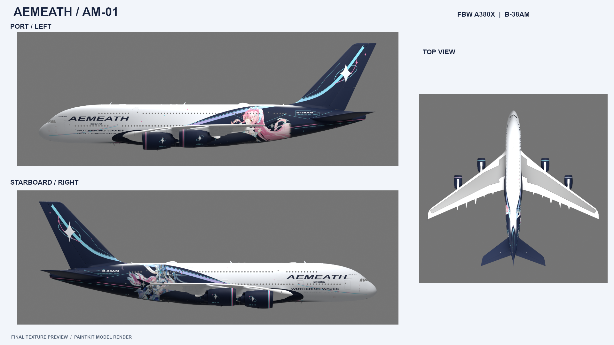

# Aemeath / AM-01 · FlyByWire A380X

《鸣潮》爱弥斯主题 A380X 虚构痛机涂装，注册号 **B-38AM**。

Pearl white, midnight blue, pink and cyan Aemeath-themed fictional repaint for FlyByWire A380X Stable, running in Microsoft Flight Simulator 2024.



## 下载与安装

[下载涂装 ZIP](https://github.com/PYZX159/aemeath-fbw-a380x/releases/download/v0.1.0/Aemeath-AM01-FBW-A380X-Stable-v0.1.0.zip) · [Release 页面](https://github.com/PYZX159/aemeath-fbw-a380x/releases/tag/v0.1.0) · [仓库内 ZIP](deliverables/Aemeath-AM01-FBW-A380X-Stable-v0.1.0.zip) · [成品文件夹](package/aemeath-fbw-a380x-stable) · [详细说明](README-zh-CN.md)

1. 下载 ZIP 并解压，得到 `aemeath-fbw-a380x-stable` 文件夹。
2. 退出 MSFS 2024，把该文件夹复制到当前实际启用的 Community 目录。
3. 确保文件夹根部直接包含 `manifest.json`、`layout.json` 和 `SimObjects`。
4. 在 FlyByWire A380X 涂装列表选择 **Aemeath / AM-01 - Guiding Starlance B-38AM**。

适用基础机模为 **FlyByWire A380X Stable 2024.1.0 非模块化版本**，基础容器为 `FlyByWire_A380_842`。新版 Native 2024 模块化包需要另行适配。

## 涂装内容

- 左右不同的爱弥斯官方素材构图，配合星轨纹章与粉青流线。
- 干净漆面，保留舱门、面板及安全标记。
- 虚构机号 B-38AM：机身两侧、左翼下方和驾驶舱铭牌。
- 主题编号 AM-01、前起落架舱门 AM / 01，以及四台发动机 01—04 编号。
- 13 张定制 DDS，均带同名 MSFS 描述文件和完整 mipmap。

## 修改与重新打包

最终可编辑的 **13 张 GIMP UV 源文件**位于 [`artwork/xcf`](artwork/xcf)。该目录包含机身、发动机、机翼、翼尖和驾驶舱机号。

在 GIMP 中修改并保存 XCF 后，从仓库根目录使用 **PowerShell 7、GIMP 3（含 DDS 插件）和 7-Zip** 重新导出：

```powershell
.\Run-Gimp.ps1 -Script export_from_xcf_gimp.py

# GIMP 安装在其他位置时：
.\Run-Gimp.ps1 -Script export_from_xcf_gimp.py -GimpExe 'D:\Apps\GIMP\bin\gimp-console-3.exe'

# 填写自己的基础机模目录；此命令校验、生成包索引并更新成品 ZIP。
.\Refresh-Delivery.ps1 -BasePackagePath 'D:\MSFS\Community\flybywire-aircraft-a380-842'
```

`Run-Gimp.ps1` 默认从当前 Windows 用户的 `LOCALAPPDATA\Programs\GIMP 3` 查找 GIMP。`Refresh-Delivery.ps1` 使用 `C:\Program Files\7-Zip\7z.exe`，并在仓库旁生成可复制的成品文件夹。

**从最终 XCF 导出无需 Blender 或飞机几何。** 两侧投影母版、角色蒙版和编号设计也保存在 `artwork/projection` 与 `artwork/source`。高级投影及预览脚本见 [`geometry/RUN-COMMANDS.md`](geometry/RUN-COMMANDS.md)；执行该流程需要在本地准备 FlyByWire paintkit 几何、UV 缓存与中性预览场景。

## 校验与素材来源

文件结构、13 张 DDS 的格式与 mipmap、描述文件、机号及基础机模引用已通过检查。预览为基于成品贴图的模型渲染，**尚未在模拟器内实测**。

[校验记录](VALIDATION.md) · [角色素材来源](references/SOURCES.md) · [第三方署名](THIRD-PARTY-NOTICES.md)

角色和系列素材来自 KURO GAMES，飞机相关基础资源来自 FlyByWire Simulations。本项目为虚构同人涂装。
